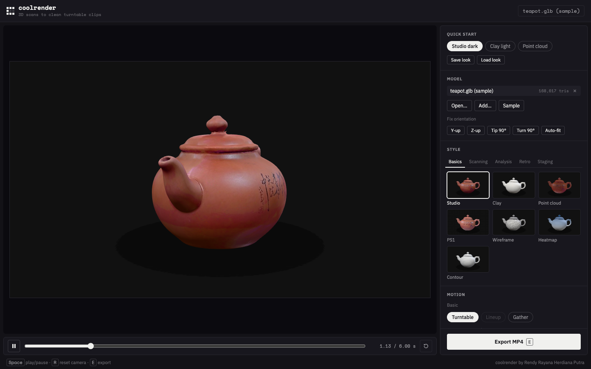
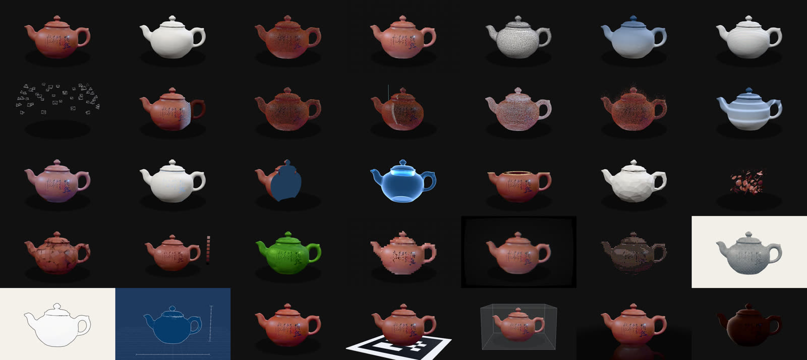

# coolrender

> From 3D scan to clean turntable video. A browser tool that renders scans as polished clips in 31 styles and exports MP4, WebM with alpha or PNG frames.


https://github.com/user-attachments/assets/fee7da98-42c2-437d-90aa-2a2a1421f404


**[Live Preview](https://rendyrayana.github.io/coolrender/)** · [Demo video](docs/demo.mp4) · [Rendy Rayana](https://rendyrayana.my.id)

## Overview

coolrender turns 3D scans and models into clean video clips. It runs entirely in the browser on the user's machine, with no install, no account and no upload: drop in a model, pick a style, press Export. Every frame is rendered at an exact time, one after another, so a slow computer takes longer but never drops a frame. A batch renderer drives the same scene from a shot list, for many clips with one look.

It was built for a presentation film on 3D-scanned cultural objects, and for designers, museum staff and researchers who need clear scan visuals without writing code.



## Features

**Import**
- Drag and drop GLB, GLTF, OBJ (+MTL and textures), PLY and STL, with a bundled sample
- Orientation helpers (Y-up, Z-up, tip, turn, auto-fit); heavy models offer to simplify to 300k triangles
- Friendly messages for unsupported files, missing textures and incompatible choices

**Style (31, in five tabs)**
- Basics: studio, clay, point cloud, PS1, wireframe, contour
- Scanning: photo rig, structured light, depth noise, LiDAR sweep, points to mesh, pixel rain
- Analysis: deviation map (viridis, shared scale), ghost overlay of rescans, section cut, X-ray, print layers, live decimation, UV unfold, texel steps, filament colours, anchor glow
- Retro and staging: CRT, halftone, ink, blueprint, tilt-shift, AR card, museum vitrine, mirror floor, low light



**Motion**
- Turn (full 360 or a gentle swing from the front), rows of up to four models
- Explode and reassemble: your own hand-arranged layout, radial, or lift
- Gather, morph, split compare, dither dissolve, glitch cut

**Look and export**
- Dark, light or transparent background, ground shadow, key and rim light, camera height, lens and margin
- 720p, 1080p, 4K or square; 24, 30 or 60 fps; seamless loop
- MP4 (H.264), WebM with transparency, or a PNG sequence as ZIP
- Presets, look files, keyboard shortcuts (Space play, R reset, E export)

**Scan tools (command line)**
- Batch renderer from a shot list: PNG frames, MP4, and ProRes 4444 for transparent shots
- Rescan alignment (scale and ICP) with per-vertex deviation in millimetres
- Assembly prep: matches separate parts to a hand-made exploded view
- Blender clean-up and simplification for large scans

## Requirements

- Node.js 20.19+ (for running it yourself)
- Modern browser with WebGL2. Chrome or Edge recommended: video export uses WebCodecs (recent Safari works too). PNG export works in any browser
- Batch mode and scan tools: Playwright's Chromium, and Blender for the optional Python scripts

## Getting Started

```bash
git clone https://github.com/rendyrayana/coolrender
cd coolrender
npm install
npm run dev
```

Open `http://localhost:3100`. Drag a model onto the stage, or click **Try the sample**, pick a look under **Quick start** or a style from the gallery, then press **Export**. The defaults give a 6-second, 1080p, 30 fps MP4. Your settings are remembered for next time.

## Tech Stack

| Library / Tool | Role |
|---|---|
| [Three.js](https://threejs.org) | 3D rendering, loaders, OrbitControls |
| [mediabunny](https://github.com/Vanilagy/mediabunny) | MP4 and WebM files with WebCodecs, including alpha |
| [meshoptimizer](https://github.com/zeux/meshoptimizer) | Mesh simplification |
| [three-mesh-bvh](https://github.com/gkjohnson/three-mesh-bvh) | Distance queries for deviation maps |
| [fflate](https://github.com/101arrowz/fflate) | PNG sequence ZIP |
| [Playwright](https://playwright.dev) and [ffmpeg](https://ffmpeg.org) | Headless batch rendering and encoding |
| [Vite](https://vitejs.dev) | Dev server and build tooling |

## Usage guide

### Supported formats

| Import | Notes |
|---|---|
| GLB, GLTF | GLB preferred. For `.gltf`, drop the `.bin` and texture files together with it. |
| OBJ | Drop the `.obj` together with its `.mtl` and images. An `.obj` dropped with just one image and no `.mtl` uses that image as its texture. |
| PLY | Meshes or point clouds, with vertex colours. |
| STL | Geometry only. |

| Export | Notes |
|---|---|
| MP4 (H.264) | Plays everywhere: PowerPoint, Keynote, phones. No transparency. |
| WebM (VP9) | Keeps a transparent background. |
| PNG sequence (.zip) | `0001.png`, `0002.png`, …, with transparency. Good for editing software. |

Video export uses WebCodecs, so use Chrome or Edge (recent Safari works too). PNG export works in any browser. Every frame is rendered at an exact time, one after another, not in real time. A slow computer takes longer, but it never drops a frame.

### The panel

- **Quick start:** built-in looks (Studio dark, Clay light, Point cloud). **Save look** stores all settings in a small `.json` file; **Load look** (or dropping the file on the stage) brings them back.
- **Model:** the loaded models, plus **Fix orientation** (Y-up, Z-up, tip, turn, auto-fit). Heavy models (over 300k triangles) trigger an offer to simplify.
- **Style:** the gallery, in tabs: Basics, Scanning, Analysis, Retro, Staging.
- **Motion:** how it moves: a turn or swing, styles blending into each other, or parts exploding and reassembling. **Options** appear below it for the chosen motion and style.
- **Look:** background (dark `#111111`, light `#F5F5F5`, transparent), ground shadow, and under **Lighting & camera** the key and rim light, camera height, lens and frame margin. Point styles get **Point options** (count, size, brightness, drift).
- **Output:** duration, resolution (720p, 1080p, 4K, square), FPS (24, 30, 60), **Loop** (constant speed, so the clip repeats seamlessly) and format.

The camera is fixed for exports: a little above the object, with a long lens, auto-fitted to the frame height with a margin. You can drag the preview to look around, and <kbd>R</kbd> resets it. Rendered frames contain only the object, never text or UI.

**Shortcuts:** <kbd>Space</kbd> play/pause · <kbd>R</kbd> reset camera · <kbd>E</kbd> export

**Friendly messages:** unsupported files, missing textures or material files, and heavy models show a message with what to do, not an error.

### Styles

| Tab | Style | What you see |
|---|---|---|
| Basics | Studio (`studio`) | Textured, as scanned |
|  | Clay (`clay`) | Light-grey and untextured: pure shape |
|  | Point cloud (`points`) | Round points sampled from the surface, in the scan’s colours |
|  | PS1 (`ps1`) | PS1 look: vertex snapping, affine textures, 15-bit colour at a low internal resolution |
|  | Wireframe (`wire`) | Clay with a thin wireframe on top |
|  | Contour (`contour`) | Topographic slice lines over clay |
| Scanning | Photo rig (`photo_rig`) | Cameras flash around the object, then the mesh appears |
|  | Structured light (`stripes`) | Structured-light stripes sweep across and build the scan |
|  | Depth noise (`depth_noise`) | Noisy Kinect-style depth points settle into a mesh |
|  | LiDAR sweep (`lidar_sweep`) | A scan line circles the object and leaves points behind |
|  | Points to mesh (`point_to_mesh`) | Points connect into triangles, then fill into a surface |
|  | Pixel rain (`pixel_rain`) | Texture pixels fall from above and settle onto the surface |
| Analysis | Deviation (`deviation`) | Distance to the raw scan on one colour scale (viridis), with a pulse. Uses stored values, a CSV dropped with the model, or a second model |
|  | Ghost overlay (`ghost_overlay`) | The raw scan solid, with rescans fading in as translucent ghosts so drift becomes visible |
|  | Anchor glow (`anchor_glow`) | Clay with carved marks and anchor areas softly glowing |
|  | Section cut (`section_cut`) | A plane slices in and shows a cross-section |
|  | X-ray (`xray`) | Translucent glowing shell |
|  | Print layers (`print_layers`) | Grows bottom-up in 3D-printer layers |
|  | Live decimation (`decimate_live`) | The triangle count drops while the silhouette holds |
|  | UV unfold (`uv_unfold`) | Flattens into its UV atlas and folds back |
|  | Texel steps (`texel_step`) | Texture resolution steps 32 → 256 px |
|  | Filament colours (`filament_snap`) | Colours snap to 8 filament swatches |
| Retro | PS1 on CRT (`crt`) | PS1 on a CRT: scanlines, curvature, glow |
|  | Halftone (`halftone`) | One-colour print dots on paper |
|  | Ink (`ink`) | Black outlines on paper white |
|  | Blueprint (`blueprint`) | White lines on blue, with grid and dimension ticks |
|  | Tilt-shift (`tilt_shift`) | Shallow depth of field: a miniature look |
| Staging | AR card (`ar_card`) | The model rises out of an AR marker card |
|  | Museum vitrine (`museum_vitrine`) | A glass case with a top light, then the glass fades away |
|  | Mirror floor (`mirror_floor`) | Glossy dark floor reflection |
|  | Low light (`low_light`) | Almost black, revealed by a circling rim light |

Most styles change over the length of the shot, and the object keeps turning while they do. Styles that play once (build-ups, reveals) don't loop seamlessly; the panel tells you when Loop is on with one of them.

### Motion

| Motion | What happens |
|---|---|
| Turn | One model, or up to four side by side, turning in sync. **Full turn** (one 360 degree turn, ease in and out, or constant speed with Loop) or **Swing** (a gentle swing each way from the front view, 40 degrees by default, so the front stays in sight). |
| Gather | Scattered points converge into the object, then drift (always the point cloud style) |
| Morph | Crossfade from Style to Second style (e.g. studio to PS1) |
| Split | A divider sweeps across: Style on the left, Second style on the right |
| Dissolve | Transition from Style to Second style through a 4x4 dither |
| Glitch | RGB-split block glitch as the cut from Style to Second style |
| Explode | Parts move out to an exploded view and back, with a small stagger. **Layout** uses your own hand-arranged exploded view, **Radial** goes straight away from the centre, **Lift** raises the parts like a stack. |

Rows of models take the room their reach needs; **Row width** (Options) makes the row fill a share of the frame width. Choices that cannot work are dimmed in the panel, with the reason on hover: for example a style that needs a mesh on a point cloud, or Explode with a style that does not draw separate parts.

**Two models:** the blend motions show a second loaded model as the second layer (a scan vs. its PS1 version, say). **Ghost overlay** shows the first model solid and the next ones as ghosts, and **Deviation** can measure the first model against the second (switch on "Measure against the second model"); both bring the two into one frame first.

**Parts:** Explode uses a model's separate meshes as parts, so export your segmented model with one mesh per part. A single scan is split into its loose pieces, or into 8 blocks.

**Explode with your own layout:** if you have the same model twice, once assembled with every part as a separate mesh and once hand-arranged into an exploded view, `scripts/prepare_parts.py` matches the parts (by name, vertex count and size), measures where each one went, simplifies per part and writes `<name>.glb` plus `<name>.layout.json`. Load both files together (or drop the layout file later onto the loaded model) and the parts move to exactly your layout. In a shot list use `"layout": "<name>.layout.json"`. The explode and reassemble times are under Options; by default they are 15%, 40%, 60% and 85% of the shot.

**Deviation and ghost overlay:** `scripts/align_scans.py` aligns rescans to their raw scan (scale and ICP), measures the distance from every rescan vertex to the raw surface in millimetres and stores it in the GLB. **Deviation** colours it on one scale (viridis, fixed range or automatic) with a sweep or ripple pulse; **Ghost overlay** fades the rescans in over the solid raw scan. Their times are under Options. Without stored values, Deviation uses a CSV dropped with the model (one number per vertex, matched by file name; OBJ values follow the `v` lines), the distance to the second model, or shows height and says so.

### Batch mode (command line)

For many shots with the same look, or for rendering without clicking:

```bash
npm install
npx playwright install chromium
npm run render -- shots.json
```

`shots.json` lists the shots. The one in this repo uses the bundled sample, so it works right away. Put your own models in `models/` (that folder is not committed).

```json
{
  "defaults": { "resolution": "1080p", "fps": 30, "bg": "dark", "rim": 1, "models": ["/sample/teapot.glb"] },
  "shots": [
    { "id": "sample_studio", "style": "studio", "anim": "turn", "seconds": 6 },
    { "id": "sample_morph", "style": "clay", "styleB": "ps1", "anim": "morph", "seconds": 6 }
  ]
}
```

A shot can set `models`, `style`, `styleB`, `anim`, `seconds`, `bg`, `loop`, `fps`, `resolution`, `width`/`height`, `shadow`, `sameSize`, `fillWidth` (lineup: share of the frame width to fill), `key`, `rim`, `turnMode`, `swing`, `explodeMode`, `motionEvents`, `styleEvents`, `heatMin`, `heatMax`, `heatScale`, `heatPulse`, `heatReference`, `layout`, `elevation`, `fov`, `margin`, `drift`, `pointCount`, `pointSize`, `pointBright`, `up: "z"`, `tip` and `rotate` (degrees about x and y; a list gives one value per model) and `heat` (a CSV in `models/`). Older names (`turntable`, `lineup`, `swing`, `swing_row`, `explode_layout`, `hand_assembly`, `heatmap`, `ghost_diff` and others) still work and are mapped to the current ones. [examples/film.json](examples/film.json) sketches a longer film; replace its model names with your files.

For each shot the renderer steps time in fixed 1/fps increments in headless Chromium, writes `renders/<id>/0001.png …`, encodes `renders/<id>.mp4` (H.264, yuv420p, CRF 16) with the bundled ffmpeg (plus a ProRes 4444 `.mov` with alpha for transparent shots), and prints the render time. Models above 300k triangles are simplified automatically. To render only some shots, add their ids: `npm run render -- shots.json sample_studio`.

`npm run dev` also shows a **Shot list** dropdown with your `shots.json`, to check framing before rendering.

**Preparing scans.** [scripts/align_scans.py](scripts/align_scans.py) and [scripts/prepare_parts.py](scripts/prepare_parts.py) (see above) prepare rescans and assembly models. [scripts/prepare_scan.py](scripts/prepare_scan.py) uses Blender to join meshes, apply a texture, simplify to a triangle budget, shrink the texture and write a GLB, with optional clean-up (stand a tilted scan upright, trim scanner floor, drop loose fragments). [scripts/obj2glb.mjs](scripts/obj2glb.mjs) converts a textured OBJ without Blender.

### Publishing

The repo has a GitHub Pages workflow ([.github/workflows/pages.yml](.github/workflows/pages.yml)). In the repository settings, set **Pages → Source** to **GitHub Actions**, then push to `main`. The build uses relative paths, so it works at any URL.

### Adding a style or animation

Each style is one file in `src/styles/` that exports `{ id, label, build(model, ctx), render?(stage) }`. Anything it builds can have `userData.update(t, look)`, which runs every frame. `src/core/shaderPatch.js` adds GLSL to normal three.js materials, and `src/styles/cloud.js` builds point clouds. Register the file in `src/styles/index.js` and give it a tab and a tooltip in `src/ui/catalog.js`; the unit tests fail if one is missing. Flags such as `perPart`, `needsMesh` and `usesOtherModels` tell the app when a style cannot work, so it dims the card instead of showing nothing. Run `npm run thumbnails` to render its gallery picture.

Each animation is one file in `src/anims/` that exports `{ id, label, maxModels, layout(items), update(items, t, look) }`; `src/anims/blend.js` makes two-style blends. Register it in `src/anims/index.js`.

### Tests

- `npm run test:unit` checks the pure logic without a browser: look validation and old-name aliases, turn and swing angles, the camera fit and row layout, explode layouts, shot lists, and that the style list, the panel tabs, the tooltips and the thumbnails all agree.
- `npm test` also drives the app like a user: it opens the sample, clicks every style card and motion chip, exports MP4, a PNG zip and a transparent WebM, and checks the unsupported-file message. Pass extra files to also check the heavy-model and missing-texture messages: `node tests/ui.mjs <out-dir> heavy.obj heavy.jpg other.obj`.
- `npm run qa` renders every style with every motion, every style on a point cloud and on a transparent background, and fails on any error or empty frame. CI runs the unit tests and this before it deploys.

## Status

Version 1.0. Built for research on communicating 3D scans of cultural objects. Feedback and issues welcome.

## License

[MIT](LICENSE). The PS1 shaders come from [lofi-viewer](https://github.com/rendyrayana/lofi-viewer). The sample teapot is a photogrammetry scan by the author.

## Links

- **Live Preview:** [rendyrayana.github.io/coolrender](https://rendyrayana.github.io/coolrender/)
- **GitHub:** [github.com/rendyrayana/coolrender](https://github.com/rendyrayana/coolrender)
- **Related:** [lofi-viewer](https://github.com/rendyrayana/lofi-viewer), from 3D scan to retro model and multi-color print
- **More projects:** [rendyrayana.my.id](https://rendyrayana.my.id)
